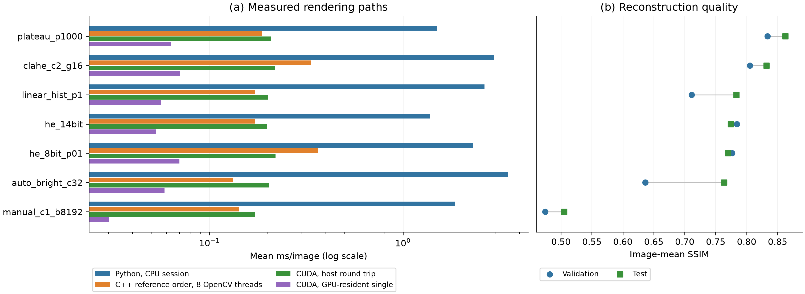

# FLIR AGC benchmark — Python, C++/OpenCV and CUDA

Reproducible comparison of **18 fixed thermal AGC settings** against paired FLIR ADAS v2 vendor JPEGs, with three implementations in one repository. It includes sources, pinned Python dependencies, build/setup scripts, complete numerical results, raw timings, integrity checks and a combined report. The dataset is obtained separately under FLIR's terms.

**[Combined report](docs/REPORT.md) · [All-algorithm quality/speed CSV](docs/tables/all_algorithms.csv) · [Every timing profile/split](docs/tables/latency_all_profiles.csv)**

## Main results

All methods use identical settings and native **640×512** inputs. Validation selects `plateau_p1000`; its held-out test SSIM is **0.8626**, mean per-image PSNR **22.03 dB**, and MAE **18.45** on the 0–255 scale.

| Implementation / timing path | Plateau HE mean ms/image |
|---|---:|
| Python, re-measured in C++ session | 1.4968 |
| C++ reference order, 1 OpenCV thread | 0.1994 |
| C++ reference order, 8 OpenCV threads | 0.1859 |
| CUDA, GPU-resident single replay | 0.0634 |
| CUDA, queued resident replays, amortized | 0.0341 |
| CUDA, complete host round trip | 0.2081 |

Use the generated report/CSV for full precision. Eight OpenCV threads do not parallelize the custom global loops; plateau differences between thread profiles reflect timing variability. Python/C++ comparisons share a timing session. CUDA was measured in a later separate session on the same CPU and input subset. GPU compute excludes transfers; it is not a substitute for complete response latency.

Reference-order C++ and CUDA match Python pixel-for-pixel across **1,144 validation + 2,151 test pairs × 18 settings per backend**. Fused C++ profiles are evaluated separately and have small output differences. The report includes speed and quality for every setting/profile rather than equating the fastest variant with the highest quality.



## Repository layout

```text
configs/default.json              Canonical 18-setting experiment specification
implementations/python/           NumPy/OpenCV reference renderer and experiment
implementations/native/           C++/OpenCV C ABI, Python bridge, C++ example
implementations/cuda/             CUDA/CUB kernels, C ABI, Python bridge, streams
scripts/setup.ps1                 Shared Windows environment, builds and tests
scripts/run_experiments.py        Sequential runner for one or all backends
scripts/check.py                  Root and backend unit tests
scripts/verify.py                 Dataset/GPU-free archive checks; optional input hashes
scripts/report.py                 Combined report, CSV tables and PNG/PDF figures
results/published/{python,native,cuda}/
                                 Original numerical results and provenance
docs/REPORT.md                    Main results, protocol, efficiency and references
requirements-lock.txt             Exact direct/transitive Python dependencies
archive_import.json               Imported-file checksums and original source identity
```

The three implementations retain independent experiment code/config snapshots to preserve recorded source hashes and cache compatibility. `configs/default.json` is the common specification; root tests check that all snapshots agree. Algorithm source files are preserved byte-for-byte; native/CUDA Python bridges additionally discover configured SDK DLL locations from the new build cache. There are no nested Git repositories or runtime dependencies on the former repositories.

## Requirements

- **Python backend/report:** Python 3.12 and the packages in `requirements-lock.txt`.
- **Native backend:** CMake, Visual Studio 2022 C++ tools/Windows SDK, OpenCV 5.0.0 C++ SDK; 7-Zip for automatic SDK extraction. Default custom build targets AVX2; use `-Portable` on older CPUs.
- **CUDA backend:** compatible NVIDIA GPU/driver, CUDA Toolkit with NVCC and CUB, CMake ≥3.24 and compatible host C++ compiler. OpenCV CUDA modules are **not** required.

Delivered runs used Windows 11, Intel Core i7-13700K (16 cores / 24 threads, 31.8 GiB RAM), and NVIDIA RTX 4070 Ti SUPER (16 GB, SM89). C++ OpenCV and the Python wheel use library version 5.0.0 but are different binary builds. The recorded CUDA compiler is **12.4.131**, not the CUDA version advertised by the driver. Full package/compiler/GPU metadata and timing limits are in the report and archived environment files.

## Setup on Windows / PowerShell

Clone and run from the repository root:

```powershell
git clone https://github.com/HrachA/flir-agc-benchmark.git
cd flir-agc-benchmark

# Python-only setup and tests (no compiler/GPU/dataset needed):
.\scripts\setup.ps1 -Backends python
```

The script creates **one root `.venv`**, installs the pinned dependencies and runs the requested tests. Build all backends:

```powershell
.\scripts\setup.ps1 -Backends python,native,cuda `
  -CudaRoot 'C:\Program Files\NVIDIA GPU Computing Toolkit\CUDA\v12.4' `
  -Architectures 89
```

The default architecture 89 matches the recorded RTX 4070 Ti SUPER; choose your GPU's compute capability for a different device (for example `-Architectures 86`). Native setup downloads/extracts the official OpenCV 5.0.0 SDK, verifies the GitHub release asset digest when supplied and records its SHA-256. To use an installed SDK, pass `-OpenCVDir 'D:\opencv\build'`. To use an explicit Python executable, pass `-Python 'C:\path\to\python.exe'`. `-SkipDependencies` reuses an already installed environment.

**Recorded compiler exception:** CUDA 12.4 is older than the installed MSVC 19.43. That specific run required the explicit `-CompatibilityOverride` switch. It enables NVIDIA/STL compiler-version overrides; tests and full parity passed, but this is not an officially supported compiler pairing. Prefer a supported toolkit/compiler combination. To reproduce the recorded build on that same pairing:

```powershell
.\scripts\setup.ps1 -Backends python,native,cuda -CompatibilityOverride
```

Manual dependency setup, including for reading results on Linux/macOS:

```powershell
py -3.12 -m venv .venv
.\.venv\Scripts\python.exe -m pip install -r requirements-lock.txt
.\.venv\Scripts\python.exe scripts/check.py --backends python
```

On Linux/macOS, substitute `python3.12` and `.venv/bin/python`. Native/CUDA CMake projects are provided, but the published build, SDK installer and setup script were validated on Windows. Do not claim other platforms were benchmarked.

## Read/verify results without the dataset or GPU

```powershell
.\.venv\Scripts\python.exe scripts/verify.py --check-export-hashes
.\.venv\Scripts\python.exe scripts/report.py
```

The verifier uses the standard library: it checks exported hashes, consistent pair manifests, complete/unique compressed quality/parity records, reference-order C++ and CUDA exactness, fused-profile separation, streaming/thread checks, and archived timing means against raw samples. Generating figures needs the pinned plotting dependencies. [GitHub Actions](.github/workflows/verify.yml) runs the CPU unit tests and archive/report checks; hosted CI does not represent CUDA execution or measured performance.

Historical timestamps/environment fields describe the original runs. Local absolute paths in archived metadata are redacted for publication; the export manifest distinguishes original and exported file hashes where applicable. Historical hashes of binaries identify the original builds, not fresh compilations. Raw metrics/timings are unchanged. `.gitattributes` disables line-ending conversion to preserve byte-based source/config/archive hashes across checkouts.

## Obtain and audit the data

Download FLIR ADAS v2 from the [official Teledyne FLIR page](https://oem.flir.com/solutions/automotive/adas-dataset-form/). Required structure:

```text
FLIR_ADAS_v2/
  images_thermal_val/
    analyticsData/<stem>.tiff
    data/<stem>.jpg
  video_thermal_test/
    analyticsData/<stem>.tiff
    data/<stem>.jpg
```

The original train split is unused. TIFF/JPEG pairs must have matching stems and dimensions. Eligible raw candidates use single-channel uint16 storage, values above 255 and no value above 16,383. **1,598 test TIFFs are already 8-bit and are excluded**; reported results cover 2,151 eligible test frames, not all 3,749. No image resizing, target-based fitting or registration is applied.

Optionally verify the source TIFF/JPEG hashes too:

```powershell
$dataset = 'D:\datasets\FLIR_ADAS_v2'
.\.venv\Scripts\python.exe scripts/verify.py --dataset-root $dataset --check-export-hashes
```

## Reproduce one or all implementations

Build the selected backends first. Run the three experiments **sequentially**; do not run latency stages concurrently with quality scoring, tests or other benchmarks:

```powershell
$dataset = 'D:\datasets\FLIR_ADAS_v2'
.\.venv\Scripts\python.exe scripts/run_experiments.py `
  --dataset-root $dataset --backends python native cuda `
  --output results/reproduction
```

The runner resolves dataset/output paths before switching backend working directories and invokes the root environment's Python. After a successful all-backend full run it generates `results/reproduction/comparison/REPORT.md` and the comparison tables/figures. The published archive is protected from overwrite by the root runner. Always use a new output directory after changes to code/config/data/dependencies/build flags.

Run only one backend or stage:

```powershell
.\.venv\Scripts\python.exe scripts/run_experiments.py --dataset-root $dataset --backends native --output results/reproduction
.\.venv\Scripts\python.exe scripts/run_experiments.py --dataset-root $dataset --backends cuda --output results/reproduction --stage latency
.\.venv\Scripts\python.exe scripts/run_experiments.py --dataset-root $dataset --backends cuda --output results/reproduction --stage batch
```

Other stages are `audit`, `quality`, `report`, and `all`; run audit before isolated stages in a new output directory. The CUDA-only `batch` stage measures four distinct frames on four streams. Use `--dry-run` to print exact commands without execution.

Native/CUDA quality stages can reuse supplied reference scores only after source/config/input/OpenCV-build hashes agree. **Both outputs are still rendered and compared for every image/setting.** Changed outputs are rescored. To recompute all reference scores, use `--no-cache`. On a platform/build that differs from the recorded OpenCV build, use `--no-cache` rather than disabling validation. Latency stages always render each call and never reuse image-dependent outputs/statistics. The native/CUDA timing subset is deliberately fixed to the recorded 128 frames; an unmatched dataset requires an explicitly new experiment specification.

For a small Python-only smoke experiment (full audit, four sampled pairs/split):

```powershell
Push-Location implementations/python
try {
  & ..\..\.venv\Scripts\python.exe -m agc_benchmark.run `
    --dataset-root $dataset --output ..\..\results\smoke\python --max-per-split 4
} finally { Pop-Location }
```

## Methods and interpretation

- Native 14-bit histogram equalization and HE after a 0.1–99.9 percentile uint8 stretch.
- CLAHE after that stretch: `(clip limit, tile count per axis)` = `(1,4), (2,8), (4,8), (2,16), (4,16)`.
- Simplified plateau HE: histogram caps 10, 100, 240, 1000; 0.1% tails.
- Linear histogram mapping: 0.1%, 1%, 5% tails; midpoint 127.
- Manual contrast 1 / brightness 8192, and auto-bright contrast 8, 32, 64.

FLIR documents AGC-processed JPEGs without publishing the precise dataset pipeline/settings. The software modes are documented approximations, **not replicas of FLIR firmware**. They omit proprietary temporal filtering, ACE/SSO/DDE and other unreported controls. Best JPEG similarity does not establish best detection performance or calibrated temperature recovery. See [the report](docs/REPORT.md) for formulas/work estimates, complete results, qualifications and primary references.

The native C ABI is in [cpp/agc.h](implementations/native/cpp/agc.h); CUDA's C ABI and borrowed device-pointer/stream interface are in [cuda/agc_cuda.h](implementations/cuda/cuda/agc_cuda.h). Both compiled renderers can be used without Python. Use one renderer/context per concurrent caller and obey buffer ownership/synchronization contracts. Input must be contiguous uint16 grayscale in 0–16,383; output is uint8 grayscale. YOLO normalization, channel expansion and inference are not included in AGC timings.

## License and citation

Original project code is provided under the [MIT license](LICENSE). OpenCV-derived CUDA CLAHE retains its separate BSD notice; dependencies retain their own licenses—see [THIRD_PARTY_NOTICES.txt](THIRD_PARTY_NOTICES.txt). FLIR images, documentation and trademarks are not relicensed or redistributed. Numerical results, hashes and generated plots that do not embed vendor images are included.

Use [CITATION.cff](CITATION.cff) to cite this software; the report cites FLIR, OpenCV, NVIDIA and the original SSIM paper. A repository/software citation does not replace the dataset's requested attribution.
