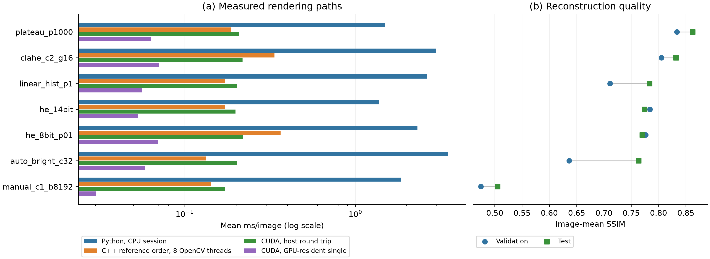
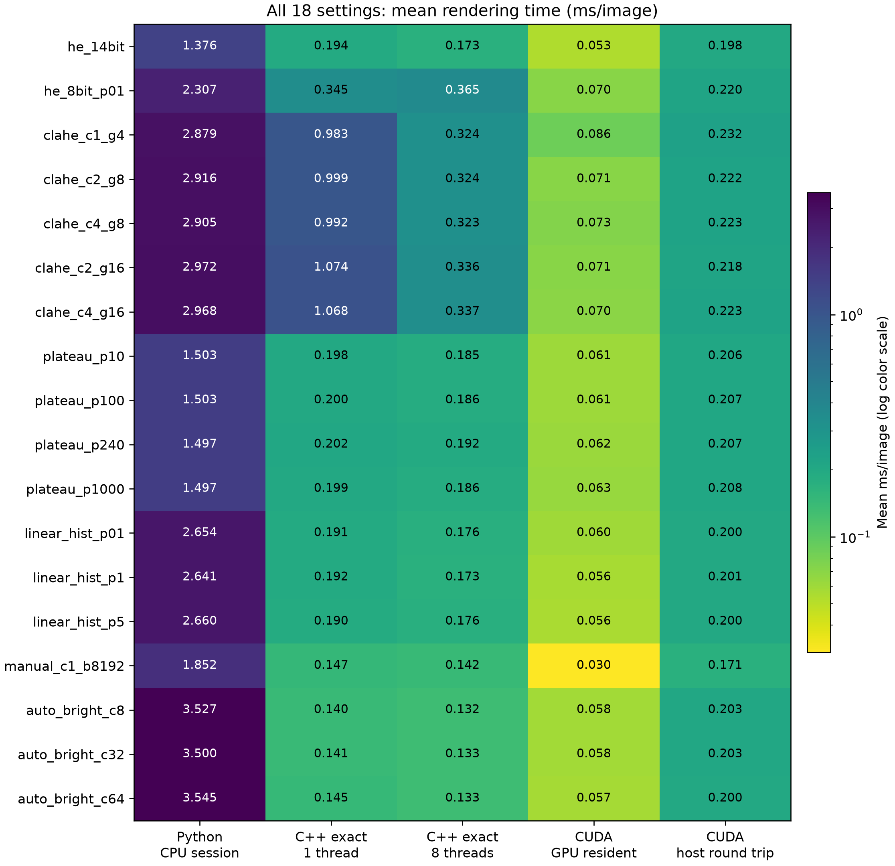

# FLIR AGC benchmark: Python, native C++/OpenCV and CUDA

## Main findings

Plateau HE with histogram cap 1000 and 0.1% tails (`plateau_p1000`) is selected by the highest validation mean SSIM, **0.8335**. It reaches test SSIM **0.8626**, mean per-image PSNR **22.03 dB**, and MAE **18.45** on the 0–255 scale.

For this setting, Python takes **1.4968 ms/image** in the native comparison session. Reference-order C++ takes **0.1994 ms** with one OpenCV thread (7.51× faster) and **0.1859 ms** with eight OpenCV threads. CUDA takes **0.0634 ms** with input/output on the GPU, or **0.2081 ms** for the complete CPU-memory-to-CPU-memory wrapper. The resident queued-replay cost is **0.0341 ms/replay**; it is an amortized microbenchmark, not individual-request latency.

**The GPU does not win every host-image comparison.** Its plateau host round trip is slower than the preceding exact C++/8 result. CUDA is most useful when input and downstream processing remain on the device; transfer and wrapper costs can outweigh compute savings for 640×512 global mappings. CLAHE benefits more from GPU parallelism. CPU and CUDA sessions were recorded separately: their differences are descriptive and are not a newly controlled simultaneous hardware comparison.

Reference-order C++ and CUDA match Python with **zero differing pixels across all 3,295 images × 18 settings per backend**. Fused C++ is a separate implementation: **52,101,047 differing pixels (0.26808258%)**, maximum difference **17** levels, and maximum absolute split-mean SSIM change **0.00001024**. Fused output must not be called bit-exact. One-vs-eight-thread and CUDA single-vs-four-stream outputs match on all 128 timing images for each setting.

## Dataset and experimental protocol

The public FLIR ADAS v2 validation/test files are matched by exact TIFF/JPEG stem and equal dimensions. The audit includes **1,144 validation + 2,151 test pairs**, all **640×512**. It excludes **1,598 test TIFFs stored as 8-bit**. Eligible inputs are single-channel uint16 TIFFs with observed values exceeding 255 and not exceeding 16,383. This checks storage and decoded range; it does not prove that every input contains 14 effective bits. The train split is unused. The dataset and vendor image examples are not redistributed.

Every method produces uint8 grayscale without resizing, registration, fitting against the target, or access to target JPEG pixels. Settings are fixed in `configs/default.json`; the test set does not select parameters. Similarity is image-mean Gaussian SSIM (11×11, σ=1.5, reflected borders over the full image), mean per-image PSNR, MAE, RMSE, Pearson correlation, and histogram Wasserstein-1 distance. This SSIM convention differs from valid-window MATLAB SSIM. Sequence-macro values and image standard deviations are retained in the original summaries. Correlated video frames and unequal sequence sizes limit interpretation of frame means. Similarity to a JPEG is not detection accuracy or temperature accuracy.

FLIR identifies processed JPEGs as AGC outputs but does not disclose the exact dataset settings [1]. These stateless software renderers approximate documented families; even the closest result does **not** identify or reproduce proprietary camera firmware, temporal filtering, ACE, SSO or DDE [2].

## Implementations and timing boundaries

| Implementation | Work performed | Important controls |
|---|---|---|
| Python | NumPy preprocessing/histograms; OpenCV HE8 and CLAHE | One OpenCV thread; OpenCL disabled; repeated temporary/output allocation |
| C++ reference order | Native histograms/LUTs and persistent workspace; OpenCV HE8/CLAHE | Exact reference arithmetic; profiles with 1/8 OpenCV threads; custom global loops remain single-threaded |
| C++ fused | Native statistics plus fused scale/offset conversions | 1/8 OpenCV threads; changed rounding/output checked independently |
| CUDA | CUB statistics/scans; custom point mappings and CLAHE; persistent buffers; CUDA Graphs | No fast math or FMA contraction; pinned staging; separate resident/transfer/host timing; four streams |

For each setting/profile, **64 validation + 64 test frames**, five repeats and warm-up produce **640 calls**; frame/method order is seeded and randomized. The Python pipeline is re-measured in the C++ timing session and is the baseline for C++ speedups. Original Python-session values are preserved in the first CPU column. CUDA uses exactly the same hashed subset in a later separate session. File I/O, decoding, scoring, compilation, context creation and workspace initialization are excluded. Each normal host call includes a newly allocated output array, bridge overhead and all rendering work; persistent internal workspace is reused and image statistics are recomputed each call.

CUDA resident-single timing is one compute-graph launch bracketed by events, after upload. It can include stream dispatch/idle gaps. Resident-queued timing is 16 queued compute replays on the same uploaded input divided by 16, not a batch of distinct frames. The GPU transfer interval includes H2D + compute + D2H under CUDA events, excluding CPU staging/allocation. Host round-trip timing includes allocation, Python/ctypes, pageable/pinned CPU copies, both transfers, compute and synchronization; that wall-clock call has no CUDA timer instrumentation. Four-stream groups process four distinct frames: 32 groups × five repeats = **160 batch observations/setting**. Batch time divided by four is amortized cost, not response latency.

Eight OpenCV threads accelerate supported stages such as CLAHE. They do not make custom C++ histogram/LUT loops eight-threaded; differences between those profiles for purely custom methods reflect timing variability. No fixed clocks, CPU affinity, power limits or isolated display scheduling were imposed. No energy-efficiency result is claimed.

## Reconstruction results

The following settings are chosen **within each family by validation SSIM**. Exact C++ and CUDA share these quality values. All settings/profiles, including fused quality changes, are in [quality_all_profiles.csv](tables/quality_all_profiles.csv).

| Family | Validation-selected setting | Val SSIM | Test SSIM | Test PSNR (dB) | Test MAE |
| --- | --- | --- | --- | --- | --- |
| he | he_14bit | 0.7840 | 0.7743 | 20.95 | 21.40 |
| he8 | he_8bit_p01 | 0.7765 | 0.7700 | 20.82 | 21.70 |
| clahe | clahe_c2_g16 | 0.8053 | 0.8320 | 18.80 | 27.72 |
| plateau | plateau_p1000 | 0.8335 | 0.8626 | 22.03 | 18.45 |
| linear_hist | linear_hist_p1 | 0.7112 | 0.7832 | 17.66 | 32.79 |
| manual | manual_c1_b8192 | 0.4747 | 0.5050 | 13.20 | 48.82 |
| auto_bright | auto_bright_c32 | 0.6363 | 0.7635 | 21.72 | 18.63 |

## CPU speed for every algorithm

All entries are mean **ms/image**. `exact` means reference-order C++; `fused` uses combined conversions. Thread counts refer to the OpenCV pool. Original Python timing and re-measured Python timing are separate columns; use the latter for within-session CPU comparisons.

| Setting | Python original | Python CPU-session | C++ exact/1 | Exact/8 | Fused/1 | Fused/8 |
| --- | --- | --- | --- | --- | --- | --- |
| he_14bit | 1.4708 | 1.3758 | 0.1940 | 0.1725 | 0.1772 | 0.1691 |
| he_8bit_p01 | 2.6626 | 2.3075 | 0.3446 | 0.3646 | 0.2947 | 0.3276 |
| clahe_c1_g4 | 3.2438 | 2.8793 | 0.9832 | 0.3241 | 0.8925 | 0.2821 |
| clahe_c2_g8 | 3.2645 | 2.9156 | 0.9994 | 0.3237 | 0.9087 | 0.2826 |
| clahe_c4_g8 | 3.2515 | 2.9054 | 0.9924 | 0.3226 | 0.9106 | 0.2845 |
| clahe_c2_g16 | 3.3338 | 2.9717 | 1.0737 | 0.3355 | 0.9816 | 0.2962 |
| clahe_c4_g16 | 3.3297 | 2.9677 | 1.0679 | 0.3370 | 0.9794 | 0.2942 |
| plateau_p10 | 1.5871 | 1.5032 | 0.1981 | 0.1847 | 0.1965 | 0.1825 |
| plateau_p100 | 1.5886 | 1.5026 | 0.2003 | 0.1862 | 0.1874 | 0.1818 |
| plateau_p240 | 1.5872 | 1.4975 | 0.2021 | 0.1917 | 0.1883 | 0.1798 |
| plateau_p1000 | 1.5763 | 1.4968 | 0.1994 | 0.1859 | 0.1882 | 0.1825 |
| linear_hist_p01 | 3.1334 | 2.6536 | 0.1911 | 0.1757 | 0.1444 | 0.1382 |
| linear_hist_p1 | 3.1283 | 2.6411 | 0.1924 | 0.1727 | 0.1448 | 0.1371 |
| linear_hist_p5 | 3.1410 | 2.6595 | 0.1905 | 0.1758 | 0.1431 | 0.1387 |
| manual_c1_b8192 | 2.2254 | 1.8519 | 0.1473 | 0.1421 | 0.0379 | 0.0353 |
| auto_bright_c8 | 4.4511 | 3.5265 | 0.1397 | 0.1323 | 0.1041 | 0.1001 |
| auto_bright_c32 | 4.4585 | 3.4997 | 0.1406 | 0.1326 | 0.1056 | 0.1003 |
| auto_bright_c64 | 4.4733 | 3.5454 | 0.1448 | 0.1329 | 0.1027 | 0.1001 |

## CUDA speed for every algorithm

All entries are **ms/image**, with the timing boundaries defined above. Resident queued and four-stream values are amortized. Do not compare resident compute directly with a transfer-inclusive CPU response and call the ratio an application speedup.

| Setting | Resident single | Resident queued | GPU transfer interval | Host round trip | 4-stream amortized |
| --- | --- | --- | --- | --- | --- |
| he_14bit | 0.0531 | 0.0260 | 0.1164 | 0.1983 | 0.1944 |
| he_8bit_p01 | 0.0699 | 0.0437 | 0.1357 | 0.2196 | 0.1951 |
| clahe_c1_g4 | 0.0863 | 0.0589 | 0.1512 | 0.2320 | 0.2663 |
| clahe_c2_g8 | 0.0711 | 0.0450 | 0.1350 | 0.2219 | 0.2164 |
| clahe_c4_g8 | 0.0727 | 0.0450 | 0.1352 | 0.2230 | 0.2136 |
| clahe_c2_g16 | 0.0706 | 0.0431 | 0.1339 | 0.2183 | 0.2151 |
| clahe_c4_g16 | 0.0695 | 0.0430 | 0.1336 | 0.2229 | 0.1972 |
| plateau_p10 | 0.0609 | 0.0341 | 0.1257 | 0.2062 | 0.2798 |
| plateau_p100 | 0.0613 | 0.0347 | 0.1283 | 0.2071 | 0.1902 |
| plateau_p240 | 0.0618 | 0.0341 | 0.1260 | 0.2069 | 0.2163 |
| plateau_p1000 | 0.0634 | 0.0341 | 0.1272 | 0.2081 | 0.2106 |
| linear_hist_p01 | 0.0595 | 0.0300 | 0.1248 | 0.2004 | 0.1808 |
| linear_hist_p1 | 0.0563 | 0.0295 | 0.1210 | 0.2012 | 0.2001 |
| linear_hist_p5 | 0.0556 | 0.0300 | 0.1225 | 0.1997 | 0.1799 |
| manual_c1_b8192 | 0.0302 | 0.0061 | 0.0937 | 0.1713 | 0.1524 |
| auto_bright_c8 | 0.0584 | 0.0306 | 0.1252 | 0.2034 | 0.1821 |
| auto_bright_c32 | 0.0585 | 0.0306 | 0.1233 | 0.2028 | 0.1823 |
| auto_bright_c64 | 0.0572 | 0.0311 | 0.1252 | 0.1998 | 0.1890 |

The [all_algorithms.csv](tables/all_algorithms.csv) file combines all 18 settings, quality, CPU profiles, CUDA timing paths, p95 values and images/s. [latency_all_profiles.csv](tables/latency_all_profiles.csv) preserves val/test/pooled mean, median, p95, standard deviation and throughput. Throughput is 1000/mean ms; four-stream throughput is 4000/mean batch ms. These are observed serial/batch rates, not detector FPS.

## Figures

Figure 1. Validation-selected settings from each AGC family, ordered by descriptive test SSIM. (a) Python, reference-order C++/8, GPU-resident CUDA and host-round-trip CUDA latency; the axis is logarithmic. (b) Validation and test reconstruction quality, identical for Python, reference-order C++ and CUDA. Connectors join the two splits and are not uncertainty intervals. CPU and GPU timings are from separate sessions; GPU residency has a different boundary and is shown separately.

Figure 2. All 18 fixed settings, using identical parameters across backends. Cells give mean ms/image; colors use a shared logarithmic scale. GPU-resident and host-round-trip columns measure different paths. These measurements cover native 640×512 frames only.

## Hardware, packages and build

Recorded CPU: **Intel Core i7-13700K**, 16 physical cores / 24 logical processors, approximately **31.8 GiB RAM**, Windows 11 build 26300. GPU: **NVIDIA GeForce RTX 4070 Ti SUPER**, 16 GB, compute capability **8.9**, 66 SMs, NVIDIA driver **610.88**, WDDM. This is the AGC experiment hardware; it does not describe a different detector experiment.

Recorded Python **3.12.14**; NumPy **2.5.4**, OpenCV Python **5.0.0.93** (library 5.0.0), Pillow **13.0.0**, matplotlib **3.11.2**, psutil **7.2.2**. All direct/transitive versions are pinned in `requirements-lock.txt`. C++ uses the official OpenCV **5.0.0** SDK, C++17, MSVC **19.43**, Release `/O2 /Oi /fp:precise /arch:AVX2`; wheel/SDK are different binary builds. CUDA uses NVCC/Toolkit **12.4.131**, runtime API **12040**, SM89, `-O3 --fmad=false --prec-div=true --prec-sqrt=true`; the driver's advertised API **13030** is not the compiler version.

CUDA 12.4 predates MSVC 19.43. The recorded build explicitly used `--allow-unsupported-compiler` and `_ALLOW_COMPILER_AND_STL_VERSION_MISMATCH`. That combination passed tests and full parity, but is not an officially supported NVIDIA compiler pairing. The setup makes this an explicit optional override; a compatible supported toolkit/compiler is preferable. The custom CUDA renderer does not require an OpenCV CUDA build. CUB comes with the separately installed toolkit [4–6].

## Work estimates and deployment

Let N=W×H, B=16,384 histogram bins and G be the CLAHE tile count. Global histogram methods are **O(N+B)**, fixed manual mapping and auto-bright are **O(N)**, and this CLAHE pipeline is **O(N+B+256G)**, including its initial 14-bit percentile normalization. Native LUT application trades per-pixel arithmetic for one lookup after a B-entry preparation. CUDA parallelizes the image statistics, scans and mappings; CPU–GPU transfers still scale with N. Complexity files describe conceptual passes/bin visits, not exact CPU instructions, FLOPs or GPU launch counts (CUB primitives can launch multiple kernels).

Each backend retains `complexity*.csv`, analytical models at five resolutions, environment/build information, input manifests, raw timings and compressed per-image quality/parity. Only 640×512 was timed; the other dimensions are modeled. CUDA `workspace.csv` reports explicit device and pinned buffers, excluding CUDA context/driver/graph overhead, so it is not peak GPU memory. Read [the reproduction guide](../README.md) for setup and integrity checks.

For a CPU-hosted application, benchmark the C++ renderer and full CUDA host path on the target device. For a GPU-resident detector, use the CUDA device-pointer/stream API, keep AGC output on-device and separately measure normalization/channel expansion/inference. The present timings exclude those YOLO steps. Accuracy, quality and resource requirements should choose the deployment; the fastest measured setting is not necessarily the closest vendor rendering.

## References

1. Teledyne FLIR, [Free ADAS thermal dataset: formats and access](https://oem.flir.com/solutions/automotive/adas-dataset-form/).
2. FLIR, [Tau 2 Product Specification, Rev. 141](https://flir.custhelp.com/ci/fattach/get/107854/0/filename/102-PS242-40-Tau2ProductSpec_Rev141.pdf), §3.3.2.6: plateau, linear histogram, manual and auto-bright modes. These mode descriptions motivate the software variants; exact firmware equivalence is not claimed.
3. OpenCV, [histogram equalization/CLAHE](https://docs.opencv.org/4.x/d5/daf/tutorial_py_histogram_equalization.html) and [CLAHE source/license](https://github.com/opencv/opencv/blob/5.0.0/modules/imgproc/src/clahe.cpp).
4. NVIDIA, [CUB parallel primitives](https://nvidia.github.io/cccl/cub/).
5. NVIDIA, [CUDA 12.4.1 event API](https://docs.nvidia.com/cuda/archive/12.4.1/cuda-runtime-api/group__CUDART__EVENT.html).
6. NVIDIA, [CUDA C++ Best Practices Guide](https://docs.nvidia.com/cuda/cuda-c-best-practices-guide/).
7. Wang, Bovik, Sheikh and Simoncelli, [Image Quality Assessment: From Error Visibility to Structural Similarity](https://ece.uwaterloo.ca/~z70wang/publications/ssim.pdf), IEEE TIP 13(4), 600–612, 2004. DOI: 10.1109/TIP.2003.819861.
