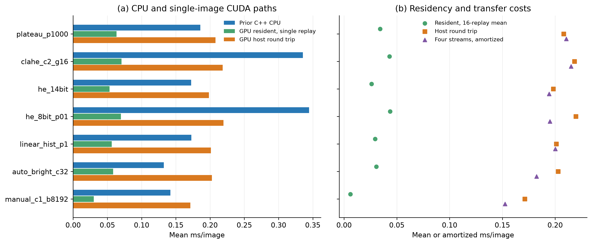

# CUDA FLIR AGC benchmark

## Main result
The validation-selected method remains **plateau_p1000**. Its mean GPU-resident single-replay interval is **0.0634 ms/image**; the average over 16 queued graph replays is **0.0341 ms/replay**. The complete CPU-memory-to-CPU-memory wrapper takes **0.2081 ms/image**, while a four-stream group takes **0.2106 ms/image amortized**. The earlier optimized C++ CPU baseline for this setting is **0.1859 ms/image**. GPU residency and transfers must therefore be reported separately; device-only timing does not establish the response time of a host-image application.

CUDA reaches test SSIM **0.8626** and PSNR **22.03 dB**. Across all 3295 images and 18 settings there are **0 differing pixels** versus the original Python renderer, maximum difference **0** levels. Four-stream outputs differ from single-stream outputs in **0 pixels** on all 128 timing frames for every setting. Full quality scores, parity details and raw timing samples are archived.

## Hardware and software
GPU: **NVIDIA GeForce RTX 4070 Ti SUPER**, compute capability 8.9, 66 SMs, 15.99 GiB device memory. CPU: **13th Gen Intel(R) Core(TM) i7-13700K**, 16 physical cores / 24 logical processors, 31.8 GiB RAM; OS Windows-11-10.0.26300-SP0. CUDA compiler/toolkit **12.4.131**, runtime API 12040, driver API 13030; NVIDIA driver details are in the NVIDIA-SMI captures. A driver advertising CUDA 13.3 does not mean Toolkit 13.3 compiled this code.

The installed host compiler is MSVC 19.43. CUDA 12.4 predates that compiler and was built with the explicit `--allow-unsupported-compiler` and `_ALLOW_COMPILER_AND_STL_VERSION_MISMATCH` overrides. This combination passed the supplied tests and full-image validation, but is not represented as an officially supported NVIDIA toolchain combination. Prefer a supported toolkit/compiler combination for production. Source, build cache and flags are archived. Kernels target SM 8.9, use -O3, disable FMA contraction, retain precise division/sqrt, and do not enable fast math.

Python 3.12.14; packages {'numpy': '2.5.4', 'opencv-python-headless': '5.0.0.93', 'Pillow': '13.0.0', 'matplotlib': '3.11.2', 'psutil': '7.2.2'}. OpenCV is used for CPU reference rendering and metrics; the rendering backend itself uses custom CUDA/CUB and does not require an OpenCV CUDA build. The GPU runs under the Windows WDDM display driver with normal desktop scheduling. Clocks, power limits and affinity are unchanged; other GPU/display activity can affect timing. These are results for the recorded GPU and implementations, not a universal fastest-possible guarantee.

## Data and method definitions
The audit retains **1144 validation and 2151 test pairs**, all 640x512; **1598 8-bit test TIFFs** are excluded. Eligible TIFFs have uint16 storage, decoded values exceeding 255 and no value above 16383. They are paired by exact stem with same-size vendor JPEGs. Inputs are hashed and never modified. No alignment, resizing or per-image fitting to the JPEG target is used.

All 18 original settings are retained: 14-bit HE, HE after an 8-bit stretch, five CLAHE clip/grid combinations, four plateau caps, three linear-histogram tail settings, fixed manual mapping and three auto-bright contrasts. Parameters are selected by validation mean SSIM; all test-setting results are descriptive. The renderers are stateless and do not reconstruct proprietary FLIR temporal filtering, ACE, SSO or DDE. FLIR documents AGC-processed JPEGs without identifying the dataset's exact processing configuration [4].

## Selected settings in each family
| Method | Prior CPU ms | GPU single ms | GPU queued/replay ms | GPU host roundtrip ms | 4-stream amortized ms | CUDA test SSIM |
| --- | --- | --- | --- | --- | --- | --- |
| plateau_p1000 | 0.186 | 0.0634 | 0.0341 | 0.2081 | 0.2106 | 0.8626 |
| clahe_c2_g16 | 0.336 | 0.0706 | 0.0431 | 0.2183 | 0.2151 | 0.8320 |
| he_14bit | 0.173 | 0.0531 | 0.0260 | 0.1983 | 0.1944 | 0.7743 |
| he_8bit_p01 | 0.345 | 0.0699 | 0.0437 | 0.2196 | 0.1951 | 0.7700 |
| linear_hist_p1 | 0.173 | 0.0563 | 0.0295 | 0.2012 | 0.2001 | 0.7832 |
| auto_bright_c32 | 0.133 | 0.0585 | 0.0306 | 0.2028 | 0.1823 | 0.7635 |
| manual_c1_b8192 | 0.142 | 0.0302 | 0.0061 | 0.1713 | 0.1524 | 0.5050 |

The CPU figures are **archived measurements from the preceding native C++ experiment**, choosing the faster of its reference-order 1/8-thread profiles for each method. They use the same CPU, dimensions and exact 128-frame subset, but were not re-measured in this CUDA session. Treat ratios as implementation/context comparisons, not a controlled same-session CPU/GPU contest. Reference CPU environment is included in reference_results/cpu_environment.json.

## CUDA implementation
The GPU keeps raw input, output, intermediate buffers, histogram counters, CUB scratch storage and graph instances allocated across frames. A pre-instantiated compute graph contains the full algorithm, without image-dependent caching. A separate graph contains pinned-memory H2D copies, the same computation, and D2H copies. CUB provides exact integer histogram/scan/reduction operations [1]. A 14-bit histogram/CDF supplies percentiles; plateau caps and CDF mapping are performed on device. Auto-bright uses a uint64 intensity sum. Manual and final mapping operations are fused into coalesced output kernels.

CLAHE uses one 256-thread block per tile, eight warp-private 256-bin histograms, parallel clipping/redistribution/CDF generation and a fused bilinear interpolation kernel. Its clipping, residual redistribution, reflect-101 padding and rounding conventions follow the OpenCV CPU definition; attribution and license are in THIRD_PARTY_NOTICES.txt [3]. Floating-point operation order is explicitly controlled where needed. No image-dependent statistics are copied to the CPU during rendering.

The device-input/output pointer and stream API permits integration into an already-GPU-resident pipeline. Output is one uint8 grayscale image; downstream YOLO channel replication, floating-point conversion and detector inference are outside this benchmark.

## Timing definitions
The exact original **64 validation + 64 test images** are loaded in RAM. Every setting has **640 timing samples**, with 20 warm-ups and five seeded, randomized repeats. Timings exclude file reading, decoding, metrics, context construction, graph capture and allocation of persistent buffers.

- **GPU single replay:** upload precedes timing. CUDA events bracket one compute-graph launch, followed by stream synchronization. It includes the graph's complete rendering and any stream/dispatch gaps between the markers, not just the sum of individual kernel durations.
- **GPU queued replay average:** CUDA events bracket 16 queued compute-graph replays on the same resident input; elapsed time is divided by 16. Every replay recomputes all statistics and output. This is an amortized microbenchmark, not single-request latency or a batch of distinct images.
- **GPU round-trip event interval:** events bracket H2D + compute + D2H in one stream. It excludes CPU copies between NumPy arrays and pinned staging buffers, Python overhead and output allocation. This is measured in a separate instrumented invocation.
- **Host round trip:** uninstrumented production render call measured with perf_counter_ns; includes a newly allocated output, Python/ctypes overhead, pageable-to-pinned CPU copy, H2D, compute, D2H, synchronization and pinned-to-output copy. No CUDA timing events are added to this measured call.
- **Four-stream group:** four distinct frames use independent workspaces/graphs/streams. Host staging is performed, graphs are queued before collecting outputs, and the synchronized wall time includes output allocation and staging copies. Mean batch time / 4 is an amortized throughput measure, not an individual frame's response latency. There are 160 batch samples per method. All 128 timing frames are also checked for batch-output equivalence.

CUDA events are outside the captured graphs; graph capture's implicit dependency events are not mistaken for recorded timing events. Event intervals can include GPU idle/scheduling gaps and have finite resolution [2]. No CUDA tests or quality scoring run concurrently with the timing stages. WDDM/desktop scheduling still prevents strict isolation.

## All configurations
| Method | GPU single | GPU queued mean | GPU transfer+compute | Host roundtrip | 4-stream/image |
| --- | --- | --- | --- | --- | --- |
| he_14bit | 0.0531 | 0.0260 | 0.1164 | 0.1983 | 0.1944 |
| he_8bit_p01 | 0.0699 | 0.0437 | 0.1357 | 0.2196 | 0.1951 |
| clahe_c1_g4 | 0.0863 | 0.0589 | 0.1512 | 0.2320 | 0.2663 |
| clahe_c2_g8 | 0.0711 | 0.0450 | 0.1350 | 0.2219 | 0.2164 |
| clahe_c4_g8 | 0.0727 | 0.0450 | 0.1352 | 0.2230 | 0.2136 |
| clahe_c2_g16 | 0.0706 | 0.0431 | 0.1339 | 0.2183 | 0.2151 |
| clahe_c4_g16 | 0.0695 | 0.0430 | 0.1336 | 0.2229 | 0.1972 |
| plateau_p10 | 0.0609 | 0.0341 | 0.1257 | 0.2062 | 0.2798 |
| plateau_p100 | 0.0613 | 0.0347 | 0.1283 | 0.2071 | 0.1902 |
| plateau_p240 | 0.0618 | 0.0341 | 0.1260 | 0.2069 | 0.2163 |
| plateau_p1000 | 0.0634 | 0.0341 | 0.1272 | 0.2081 | 0.2106 |
| linear_hist_p01 | 0.0595 | 0.0300 | 0.1248 | 0.2004 | 0.1808 |
| linear_hist_p1 | 0.0563 | 0.0295 | 0.1210 | 0.2012 | 0.2001 |
| linear_hist_p5 | 0.0556 | 0.0300 | 0.1225 | 0.1997 | 0.1799 |
| manual_c1_b8192 | 0.0302 | 0.0061 | 0.0937 | 0.1713 | 0.1524 |
| auto_bright_c8 | 0.0584 | 0.0306 | 0.1252 | 0.2034 | 0.1821 |
| auto_bright_c32 | 0.0585 | 0.0306 | 0.1233 | 0.2028 | 0.1823 |
| auto_bright_c64 | 0.0572 | 0.0311 | 0.1252 | 0.1998 | 0.1890 |

All times above are milliseconds. latency_summary.csv additionally reports medians, p95, standard deviations and throughput. The queued-replay p95 is a percentile of replay-group averages; it is not a per-request tail latency. batch_summary.csv preserves full four-image batch latency and throughput.

## Quality and integrity
Every image is rendered by the original Python reference and by CUDA, then compared pixel-for-pixel. Hash-validated cached reference similarity scores are reused only for identical predictions. Changed predictions are rescored against the vendor JPEG. `--no-cache` recomputes all reference metrics. SSIM uses the prior full-frame reflected-border Gaussian convention (11x11, sigma 1.5); PSNR is averaged per image; MAE/RMSE use grayscale units. Pearson correlation and histogram Wasserstein distance are also reported [5]. Sequence-macro scores accompany image means because neighboring frames are dependent. High reconstruction similarity does not establish detection accuracy or temperature calibration.

## Work and memory estimates
For N=W*H, B=16384 and G CLAHE tiles, global histogram pipelines have O(N+B) work; manual mapping and auto-bright have O(N); CLAHE has O(N+B+G*256). GPU parallelism changes execution time, not these asymptotic counts. CUB can use multiple internal kernels, so a pipeline stage is not necessarily one kernel launch. complexity_cuda.csv and complexity_scaling.csv give approximate stage/work models at five resolutions; these are not measured instruction counts or FLOPs.

workspace.csv gives actual explicitly allocated device-buffer bytes for each method, plus 3N bytes of pinned host staging. Only buffers needed by the selected family are allocated. Four streams require four independent workspaces. CUDA context, graph/event objects, driver allocations, allocator overhead and unrelated display memory are excluded; this is not a total GPU-memory or peak-memory measurement. Graph capture and initial allocations are excluded from steady-state timing.

The measured host path demonstrates why transfer-inclusive performance must be checked for small images. If the application already keeps images on the GPU, the resident graph path avoids those transfers. If each frame starts and ends in CPU memory, compare the host-roundtrip or streamed measurements with CPU implementations before selecting a backend.

Suggested caption: AGC implementation efficiency on the recorded RTX 4070 Ti SUPER and Intel Core i7-13700K. Left: archived native CPU timing, GPU-resident single-graph intervals, and transfer-inclusive host wall time. Right: queued GPU replay averages, host round trips and four-stream amortized cost. Settings are validation-selected. Queued replays and four-stream averages represent amortized throughput; they are not single-request response latency. CPU measurements come from the preceding experiment.

## References
1. NVIDIA, [CUB device primitives](https://nvidia.github.io/cccl/cub/), histogram, scan and reduction APIs (the build uses the version bundled with CUDA 12.4).
2. NVIDIA, [CUDA 12.4 event timing](https://docs.nvidia.com/cuda/archive/12.4.1/cuda-runtime-api/group__CUDART__EVENT.html) and [CUDA Best Practices](https://docs.nvidia.com/cuda/cuda-c-best-practices-guide/), streams, graphs, pinned memory and transfer minimization.
3. OpenCV, [CLAHE implementation and license](https://github.com/opencv/opencv/blob/5.0.0/modules/imgproc/src/clahe.cpp).
4. Teledyne FLIR, [ADAS dataset formats](https://oem.flir.com/solutions/automotive/adas-dataset-form/) and [Tau 2 Product Specification, Rev. 141](https://flir.custhelp.com/ci/fattach/get/107854/0/filename/102-PS242-40-Tau2ProductSpec_Rev141.pdf), section 3.3.2.6.
5. Wang et al., [Image Quality Assessment: From Error Visibility to Structural Similarity](https://ece.uwaterloo.ca/~z70wang/publications/ssim.pdf), IEEE TIP 13(4), 600-612, 2004, DOI 10.1109/TIP.2003.819861.

References checked 4 November 2026. README.md provides compilation, tests, complete reproduction and device-resident integration instructions. Source/DLL hashes, compiler settings, manifests, CPU/GPU metadata and raw measurements accompany this report.
