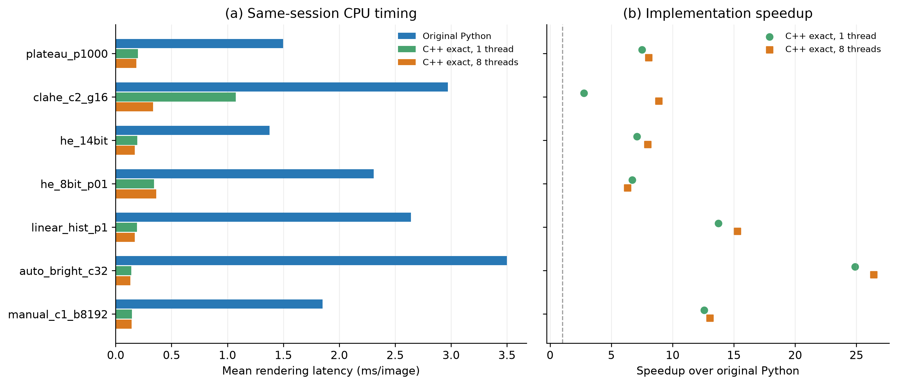

# Native OpenCV/C++ AGC benchmark

## Main finding
The original validation-selected method, **plateau_p1000**, takes **0.199 ms/image** in reference-order C++ at one thread, versus **1.497 ms** for the re-measured Python pipeline: **7.51x** faster. Its reference-order/8-thread profile takes **0.186 ms** (**8.05x**). Threads accelerate only eligible OpenCV stages; the custom global histogram and LUT loops remain single-threaded. For plateau HE both thread profiles execute the same single-threaded kernel, so their timing difference reflects run variability rather than parallel acceleration.

The reference-order C++ result reaches test SSIM **0.8626** and PSNR **22.03 dB**. This is the fastest tested implementation comparison under the recorded settings, not proof of the fastest possible code on all CPUs.

## What was implemented
All 18 settings from the previous experiment are implemented. OpenCV's native **cv::equalizeHist** and **cv::CLAHE** perform HE8 and CLAHE [1,2]. Native 14-bit HE and plateau HE use custom histogram/CDF/LUT code. Percentile bounds, manual mapping, auto-bright and linear-histogram mappings are native C++; the fused profile uses SIMD-dispatched **Mat::convertTo** for point mappings [3]. The detector, GPU and learned renderers are not involved.

Optimizations include four independent histogram accumulators, unrolled LUT application, reusable histogram/LUT/CLAHE workspace, and replacing repeated per-pixel arithmetic with a 16384-entry LUT in the reference-order profile. The fused profile combines scale, offset, clipping and conversion in OpenCV. Custom code is compiled in Release with MSVC /O2 /Oi /fp:precise and AVX2 enabled. Fast-math reassociation is not enabled. Library dispatch, SIMD support and compiler details are recorded.

The Python HE/CLAHE calls already used C++ internally. Speed gains therefore come from the surrounding preprocessing, fewer temporaries, persistent workspace, native loops and threading; they should not be attributed entirely to replacing Python with C++.

## Data and quality checks
The audit retains **1144 validation and 2151 test pairs**, all 640x512. It excludes 1598 TIFFs stored as 8-bit. Source files are unchanged, matched by exact stem and decoded without resizing. Each accepted pair has TIFF/JPEG SHA-256 hashes. The methods are defined in configs/default.json and inherited without test tuning.

Reference-order C++ versus Python: **0 differing pixels**, maximum absolute difference **0** gray levels, over all 3295 images x 18 settings. Fused C++: **52,101,047 differing pixels (0.26808258%)**, maximum absolute difference **17**. The largest absolute change in a split-level mean SSIM is **0.00001024**. Full per-image differences and all reconstruction metrics are archived; changed outputs are scored against the vendor JPEG. Exact matches reuse the hash-validated previous metric values. `--no-cache` recomputes every reference metric.

Reference-order and fused results with 1 and 8 OpenCV threads differ in **0 pixels** over every setting on all 128 timing images. Quality scores are computed at one thread; the 8-thread equivalence check is limited to the timing subset and is not represented as a full-dataset proof.

## Validation-selected settings per family
Settings are selected by the original Python validation SSIM, so speed comparisons use identical parameters. All native variants also have independent validation-based selection recorded in selection.csv.

| Method | Python ms | C++ exact/1 ms | Exact/1 speedup | C++ exact/8 ms | Exact/8 speedup | Exact test SSIM |
| --- | --- | --- | --- | --- | --- | --- |
| plateau_p1000 | 1.497 | 0.199 | 7.51x | 0.186 | 8.05x | 0.8626 |
| clahe_c2_g16 | 2.972 | 1.074 | 2.77x | 0.336 | 8.86x | 0.8320 |
| he_14bit | 1.376 | 0.194 | 7.09x | 0.173 | 7.98x | 0.7743 |
| he_8bit_p01 | 2.307 | 0.345 | 6.70x | 0.365 | 6.33x | 0.7700 |
| linear_hist_p1 | 2.641 | 0.192 | 13.72x | 0.173 | 15.29x | 0.7832 |
| auto_bright_c32 | 3.500 | 0.141 | 24.89x | 0.133 | 26.40x | 0.7635 |
| manual_c1_b8192 | 1.852 | 0.147 | 12.57x | 0.142 | 13.03x | 0.5050 |

## CPU timing protocol
CPU **13th Gen Intel(R) Core(TM) i7-13700K**, 16 physical cores / 24 logical processors, 31.8 GiB RAM; Windows-11-10.0.26300-SP0; Python 3.12.14. Packages: {'numpy': '2.5.4', 'opencv-python-headless': '5.0.0.93', 'Pillow': '13.0.0', 'matplotlib': '3.11.2', 'psutil': '7.2.2'}. Native compiler: MSVC 1943; C++17; /O2 /Oi /fp:precise; AVX2 when enabled by CMake. The official OpenCV C++ SDK is version 5.0.0; the Python wheel is also OpenCV 5.0.0, but they are different binary builds, whose full configuration dumps accompany the results.

The original seeded **64 validation + 64 test frames** are loaded into RAM. There are **640 timed calls per engine/setting** (five repeats), with 20 warm-ups per setting after every engine/thread-profile switch. Engine-block order and frame/method order are seeded and randomized across repeats. Timing includes Python-to-native bridge overhead and a newly allocated output array for every call, as well as all rendering work; internal renderer workspace is reused. There is no hidden precomputed per-image histogram, LUT or output. Baseline Python is re-measured in the same session rather than using historical timings.

Timing excludes image decoding, file I/O, metrics, compilation and one-time renderer construction. GPU/OpenCL are disabled in both OpenCV builds. Python OpenCV uses one thread. Native profiles request one or eight OpenCV threads, without process affinity, fixed clocks or real-time scheduling. Native custom histogram and LUT stages are not parallelized. Thread changes occur outside timed intervals, followed by warm-up. Mean, median, p95, standard deviation, images/s, nanoseconds/pixel and speedups are in latency_summary.csv. Host load and hybrid P/E-core scheduling can affect results. Speedups compare implementations and build/thread choices, not language alone.

## Every fixed setting
| Method | Python ms | C++ exact/1 | C++ exact/8 | C++ fused/1 | C++ fused/8 | Exact/8 speedup | Fused/8 speedup |
| --- | --- | --- | --- | --- | --- | --- | --- |
| he_14bit | 1.376 | 0.194 | 0.173 | 0.177 | 0.169 | 7.98x | 8.13x |
| he_8bit_p01 | 2.307 | 0.345 | 0.365 | 0.295 | 0.328 | 6.33x | 7.04x |
| clahe_c1_g4 | 2.879 | 0.983 | 0.324 | 0.893 | 0.282 | 8.89x | 10.21x |
| clahe_c2_g8 | 2.916 | 0.999 | 0.324 | 0.909 | 0.283 | 9.01x | 10.32x |
| clahe_c4_g8 | 2.905 | 0.992 | 0.323 | 0.911 | 0.284 | 9.01x | 10.21x |
| clahe_c2_g16 | 2.972 | 1.074 | 0.336 | 0.982 | 0.296 | 8.86x | 10.03x |
| clahe_c4_g16 | 2.968 | 1.068 | 0.337 | 0.979 | 0.294 | 8.81x | 10.09x |
| plateau_p10 | 1.503 | 0.198 | 0.185 | 0.196 | 0.182 | 8.14x | 8.24x |
| plateau_p100 | 1.503 | 0.200 | 0.186 | 0.187 | 0.182 | 8.07x | 8.26x |
| plateau_p240 | 1.497 | 0.202 | 0.192 | 0.188 | 0.180 | 7.81x | 8.33x |
| plateau_p1000 | 1.497 | 0.199 | 0.186 | 0.188 | 0.182 | 8.05x | 8.20x |
| linear_hist_p01 | 2.654 | 0.191 | 0.176 | 0.144 | 0.138 | 15.10x | 19.21x |
| linear_hist_p1 | 2.641 | 0.192 | 0.173 | 0.145 | 0.137 | 15.29x | 19.27x |
| linear_hist_p5 | 2.660 | 0.190 | 0.176 | 0.143 | 0.139 | 15.12x | 19.17x |
| manual_c1_b8192 | 1.852 | 0.147 | 0.142 | 0.038 | 0.035 | 13.03x | 52.40x |
| auto_bright_c8 | 3.527 | 0.140 | 0.132 | 0.104 | 0.100 | 26.65x | 35.21x |
| auto_bright_c32 | 3.500 | 0.141 | 0.133 | 0.106 | 0.100 | 26.40x | 34.90x |
| auto_bright_c64 | 3.545 | 0.145 | 0.133 | 0.103 | 0.100 | 26.68x | 35.44x |

## Quantization sensitivity on test
| Method | Fused max error | Changed pixels | Python SSIM | Fused SSIM | SSIM change |
| --- | --- | --- | --- | --- | --- |
| he_14bit | 0 | 0.000000% | 0.774293 | 0.774293 | +0.00000000 |
| he_8bit_p01 | 12 | 0.168797% | 0.769999 | 0.769999 | +0.00000024 |
| clahe_c1_g4 | 3 | 0.406292% | 0.813960 | 0.813957 | -0.00000251 |
| clahe_c2_g8 | 6 | 0.581058% | 0.834447 | 0.834447 | +0.00000054 |
| clahe_c4_g8 | 6 | 0.958710% | 0.778510 | 0.778514 | +0.00000444 |
| clahe_c2_g16 | 14 | 0.575371% | 0.832041 | 0.832040 | -0.00000037 |
| clahe_c4_g16 | 17 | 0.824930% | 0.766527 | 0.766529 | +0.00000175 |
| plateau_p10 | 0 | 0.000000% | 0.758886 | 0.758886 | +0.00000000 |
| plateau_p100 | 0 | 0.000000% | 0.822316 | 0.822316 | +0.00000000 |
| plateau_p240 | 0 | 0.000000% | 0.840141 | 0.840141 | +0.00000000 |
| plateau_p1000 | 0 | 0.000000% | 0.862593 | 0.862593 | +0.00000000 |
| linear_hist_p01 | 1 | 0.325795% | 0.713936 | 0.713937 | +0.00000120 |
| linear_hist_p1 | 1 | 0.418407% | 0.783216 | 0.783225 | +0.00000887 |
| linear_hist_p5 | 1 | 0.707900% | 0.744620 | 0.744616 | -0.00000395 |
| manual_c1_b8192 | 0 | 0.000000% | 0.504990 | 0.504990 | +0.00000000 |
| auto_bright_c8 | 1 | 0.005940% | 0.572628 | 0.572628 | -0.00000012 |
| auto_bright_c32 | 1 | 0.023591% | 0.763459 | 0.763458 | -0.00000101 |
| auto_bright_c64 | 0 | 0.000000% | 0.746714 | 0.746714 | +0.00000000 |

Replacing the explicit arithmetic order with one scale/offset conversion changes rounding near quantization thresholds. For histogram-based postprocessing this can affect more than a single gray level after equalization. The reference-order profile is provided when preserving the original rendering is more important than the fastest measured path. Consult the full parity CSV before claiming bit-exact replacement.

## Algorithmic work and memory
Let N=W*H, B=16384 and G be the number of CLAHE tiles. Native global mappings are O(N+B); fused manual and auto-bright are O(N); CLAHE is O(N+B+G*256). The asymptotic order generally matches Python, but native code removes large temporary arrays and moves arithmetic from N pixels to B LUT entries. Four histogram accumulators trade extra small workspace for independent updates.

Each renderer reserves approximately **21B = 344064 bytes** of global histogram/LUT workspace, plus the temporary 8-bit base image for HE8/CLAHE and OpenCV's internal tile buffers. Output memory is N bytes per call. Workspace is allocated once, not counted as a fresh allocation each frame. complexity_native.csv and complexity_scaling.csv provide explicit coarse pixel/bin-visit proxies at five resolutions. Those estimates are not CPU instruction counts or FLOPs; no cycle counters or energy measurements are claimed. Only 640x512 latency is empirically measured.

Suggested caption: CPU rendering latency and speedup for the validation-selected setting in each AGC family on an Intel Core i7-13700K. Baseline Python and reference-order C++ requesting one or eight OpenCV threads use the same in-memory image subset and include output allocation. Threading applies only to supported OpenCV stages; the custom global histogram/LUT kernels remain single-threaded. Fused-mode timings and quantization differences are reported separately.

## Limitations and references
These are software implementations inspired by documented FLIR modes [4], not camera firmware. The vendor's exact ADAS JPEG processing settings are undisclosed [5]. Differences from the vendor rendering can remain even with bit-exact agreement to our previous implementation. Results apply to the eligible high-bit-depth subset and tested parameter grid; reconstruction similarity does not establish detection accuracy.

1. OpenCV, [equalizeHist](https://docs.opencv.org/4.x/d6/dc7/group__imgproc__hist.html).
2. OpenCV, [CLAHE class](https://docs.opencv.org/4.x/d6/db6/classcv_1_1CLAHE.html).
3. OpenCV, [Mat::convertTo](https://docs.opencv.org/4.x/d3/d63/classcv_1_1Mat.html) and [official OpenCV 5.0.0 release](https://github.com/opencv/opencv/releases/tag/5.0.0).
4. FLIR, [Tau 2 Product Specification, Rev. 141](https://flir.custhelp.com/ci/fattach/get/107854/0/filename/102-PS242-40-Tau2ProductSpec_Rev141.pdf), section 3.3.2.6.
5. Teledyne FLIR, [ADAS dataset formats](https://oem.flir.com/solutions/automotive/adas-dataset-form/).
6. Wang et al., [Structural Similarity](https://ece.uwaterloo.ca/~z70wang/publications/ssim.pdf), IEEE TIP 13(4), 600-612, 2004, DOI 10.1109/TIP.2003.819861. SSIM uses the prior full-frame reflected-border 11x11 Gaussian convention (sigma 1.5); MAE/RMSE use gray-level units and PSNR is averaged per image.

See README.md for setup, compilation, testing, complete reproduction and fresh-metric commands. Package pins, official SDK digest, compiler/build information, source/binary hashes, manifests and raw timings accompany the results. References checked 4 November 2026.
