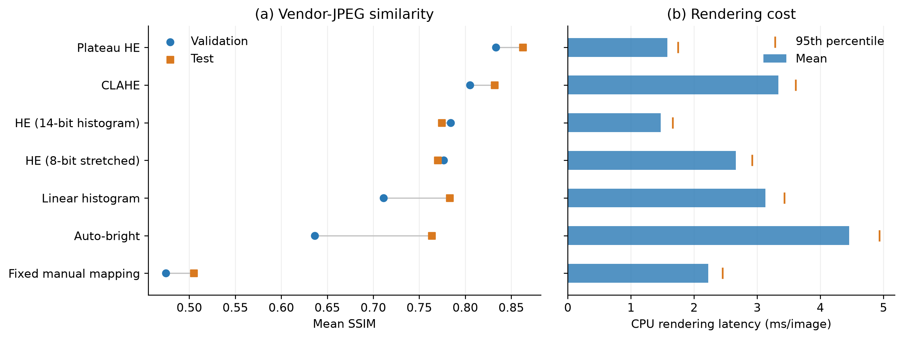

# FLIR ADAS v2 paired-image AGC benchmark

## Main result
The validation-selected method is **plateau_p1000**. On the eligible test pairs it reaches mean SSIM **0.8626**, mean per-image PSNR **22.03 dB**, MAE **18.45 gray levels**, and RMSE **21.03 gray levels**. Its CPU rendering latency averages **1.576 ms/image**, with a 95th percentile of **1.748 ms**. This identifies the closest tested rendering by validation SSIM, not the vendor's actual algorithm.

## Data and protocol
The run uses 1144 validation and 2151 test TIFF/JPEG pairs. Files are matched by exact stem within each original split; dimensions must agree and no alignment, resizing, intensity fitting to a target, or reference-assisted processing is allowed. Native eligible dimensions: 640x512. The audit checks all 4893 TIFFs and excludes 1598 files: {'not_uint16_source': 1598}. Eligibility requires uint16 storage, a decoded maximum above 255 and no value above 16383. This is an operational high-bit-depth criterion, not proof of sensor calibration or usable 14-bit precision. Results apply to this eligible subset, not all original test frames. File hashes and exact exclusions are archived.

All 18 configurations are fixed before quality scoring. Parameters and method families are selected only using validation image-mean SSIM; test rankings for all settings are descriptive. Test images are not used to fit parameters. No learned model or detector is trained. Consecutive frames are dependent: standard deviations describe image variability, not confidence intervals. Equal-weight per-sequence means are provided as a sensitivity analysis in quality_summary.csv. Validation/test are never pooled for similarity scores.

## Selected setting in each family
| Method (chosen on val) | Val SSIM | Test SSIM | Test PSNR (dB) | Test MAE | CPU mean (ms) | CPU p95 (ms) |
| --- | --- | --- | --- | --- | --- | --- |
| plateau_p1000 | 0.8335 | 0.8626 | 22.03 | 18.45 | 1.576 | 1.748 |
| clahe_c2_g16 | 0.8053 | 0.8320 | 18.80 | 27.72 | 3.334 | 3.609 |
| he_14bit | 0.7840 | 0.7743 | 20.95 | 21.40 | 1.471 | 1.662 |
| he_8bit_p01 | 0.7765 | 0.7700 | 20.82 | 21.70 | 2.663 | 2.921 |
| linear_hist_p1 | 0.7112 | 0.7832 | 17.66 | 32.79 | 3.128 | 3.430 |
| auto_bright_c32 | 0.6363 | 0.7635 | 21.72 | 18.63 | 4.459 | 4.934 |
| manual_c1_b8192 | 0.4747 | 0.5050 | 13.20 | 48.82 | 2.225 | 2.453 |

SSIM uses 11x11 Gaussian windows, sigma 1.5, population local moments, C1=(0.01*255)^2 and C2=(0.03*255)^2, reflected borders, and an average over the full image [4]. This follows our prior study convention but is not a bit-for-bit reproduction of the paper's original MATLAB valid-window SSIM. PSNR, MAE, RMSE, Pearson correlation, and grayscale histogram Wasserstein-1 distance provide complementary measures. PSNR is averaged per image, not calculated from pooled MSE; no image is resized for scoring. High SSIM does not establish good detection accuracy or radiometric accuracy.

The selected plateau setting has test Pearson correlation 0.9917 but a remaining MAE of 18.45 levels: strong intensity co-variation therefore does not imply an exact vendor-image match. The table also shows that CLAHE improves SSIM over ordinary HE while having lower PSNR, so structural similarity and absolute pixel fidelity give different rankings. Plateau HE's remaining gap should not be attributed to any one unpublished camera-processing stage from these aggregate results alone.

Within the validation-selected family settings, the validation-SSIM versus CPU-mean-latency Pareto set is: plateau_p1000, he_14bit. A method is excluded from this set if another selected setting is at least as similar on validation and no slower, with one strict improvement. This is a descriptive trade-off, not a claim that the algorithms are optimized equally. Image-macro and sequence-macro scores should both be checked because long sequences can dominate frame averages. Eligible data contain 17 validation and 6 test sequences.

## Methods and interpretation
HE on the 14-bit histogram uses a cumulative mapping with the first occupied cumulative count subtracted. A second HE baseline applies OpenCV equalization after 0.1-99.9 percentile conversion to uint8. Five CLAHE configurations combine (clip limit, grid per axis) = (1,4), (2,8), (4,8), (2,16), and (4,16) on that same 8-bit stretch [3]. A grid of 8 means 8x8 tiles, not 8x8 pixels. The stretch cost is included.

The plateau implementation clips 16384-bin histogram counts at 10, 100, 240, or 1000 after 0.1% tail rejection, then maps the normalized clipped CDF to uint8. Clipped mass is discarded rather than redistributed. It is a simplified, stateless software implementation inspired by the documented plateau method [2]; it does not reproduce proprietary maximum-gain limiting, ACE, SSO, DDE, ROI tuning, temporal IIR or camera firmware quantization.

Three additional documented Tau 2 mode families are tested [2]: linear histogram mapping (0.1%, 1%, or 5% symmetric tails, midpoint 127); fixed manual mapping (contrast 1, brightness 8192); and auto-bright (contrast 8, 32, or 64). Manual uses y=clip(round[127+(I-brightness)*contrast/64]); auto-bright replaces brightness with the frame mean. Linear histogram scales the retained range to 255 gray levels around midpoint 127. Integer histogram percentiles use linear order-statistic interpolation. All custom output rounding uses nearest-even; optional firmware filtering and enhancements are omitted. The tested parameter grid is not claimed to be FLIR defaults or exhaustive.

FLIR identifies the dataset thermal formats as pre-AGC TIFF and AGC-processed JPEG [1]. Its public dataset page does not identify the exact AGC mode or settings. Missing temporal state, optional detail processing, JPEG compression, and the tested finite parameter grid can all limit agreement. In particular, a global monotonic map cannot reproduce arbitrary spatially varying contrast changes. These comparisons measure vendor-image reconstruction rather than recovering the camera's processing pipeline.

## CPU timing and environment
CPU: **13th Gen Intel(R) Core(TM) i7-13700K**, 16 physical cores / 24 logical processors; RAM 31.8 GiB; OS Windows-11-10.0.26300-SP0. Registry nominal frequency: 3418 MHz; actual boost frequency is not controlled. Python 3.12.14; packages {'numpy': '2.5.4', 'opencv-python-headless': '5.0.0.93', 'Pillow': '13.0.0', 'matplotlib': '3.11.2', 'psutil': '7.2.2'}. No GPU or OpenCL is used. OpenCV uses 1 thread(s). Quality scoring uses 4 outer workers; latency is measured sequentially in one process, separately from metrics.

Each algorithm receives the same seeded subset of up to 64 eligible frames per split, loaded into RAM. After 20 warm-ups per configuration, 5 repetitions randomize frame and algorithm order. Timing encloses all rendering, histogram construction, stretching, output allocation and quantization, but excludes disk I/O, decoding, metrics, plot generation, and one-time renderer construction. Latency samples are in latency_samples.csv. Pooled latency mixes the two equally sampled split subsets; split-specific timings are also provided. Desktop background load and uncontrolled scheduling/boost mean these are host-specific measurements, not hardware-independent complexity.

The timings characterize these Python/NumPy/OpenCV implementations; they are not measurements of in-camera FLIR firmware or dedicated image-processing hardware.

## Approximate algorithmic work
Let N=width*height (327680 for 640x512), B=16384 histogram bins, and G=number of CLAHE tiles. Fixed manual mapping and auto-bright are O(N). Global HE, percentile-linear mapping, and plateau HE are O(N+B). CLAHE adds tile histograms, clipping/CDFs and interpolation: O(N+B+G*256) here, including the 14-bit-to-8-bit preparation. At fixed B and tile count all methods scale linearly with pixel count. CLAHE work per pixel is greater because several neighboring tile mappings are interpolated.

complexity.csv records an explicit approximate pixel/bin-visit proxy (roughly one to four full-image passes plus histogram work), including the numeric estimate at 640x512. These are coarse work estimates, not exact CPU instructions, FLOPs, cycle counts, or measured hardware counters. NumPy/OpenCV kernels perform multiple arithmetic and memory operations per visit. Additional storage is O(N+B) for global methods and O(N+B+G*256) for CLAHE.

| Selected method | Approximate work proxy | Visits at 640x512 | Asymptotic cost |
| --- | --- | --- | --- |
| he_14bit | 2N + 32768 | 688,128 | O(N + 16384) |
| he_8bit_p01 | 4N + 49664 | 1,360,384 | O(N + 16384) |
| clahe_c2_g16 | 4N + 245760 | 1,556,480 | O(N + G*256 + 16384) |
| plateau_p1000 | 2N + 81920 | 737,280 | O(N + 16384) |
| linear_hist_p1 | 2N + 49152 | 704,512 | O(N + 16384) |
| manual_c1_b8192 | 1N + 0 | 327,680 | O(N) |
| auto_bright_c32 | 2N + 0 | 655,360 | O(N) |

An image-pass equivalent counts a conceptual histogram, point mapping, mean reduction, or image traversal, rather than every memory load or vectorized arithmetic subexpression. For example, the HE proxy counts one histogram pass and one LUT-application pass, plus approximate bin processing. This makes the resolution dependence explicit without claiming implementation-independent primitive instruction counts.

## All fixed configurations
| Method | Val SSIM | Val PSNR (dB) | Test SSIM (descriptive) |
| --- | --- | --- | --- |
| plateau_p1000 | 0.8335 | 23.75 | 0.8626 |
| clahe_c2_g16 | 0.8053 | 17.28 | 0.8320 |
| clahe_c2_g8 | 0.8047 | 17.48 | 0.8344 |
| clahe_c4_g8 | 0.7923 | 16.78 | 0.7785 |
| plateau_p240 | 0.7903 | 18.87 | 0.8401 |
| clahe_c4_g16 | 0.7899 | 16.94 | 0.7665 |
| he_14bit | 0.7840 | 23.66 | 0.7743 |
| he_8bit_p01 | 0.7765 | 23.62 | 0.7700 |
| clahe_c1_g4 | 0.7719 | 17.50 | 0.8140 |
| plateau_p100 | 0.7527 | 17.56 | 0.8223 |
| plateau_p10 | 0.7115 | 16.90 | 0.7589 |
| linear_hist_p1 | 0.7112 | 15.62 | 0.7832 |
| linear_hist_p01 | 0.7029 | 16.85 | 0.7139 |
| linear_hist_p5 | 0.6759 | 14.52 | 0.7446 |
| auto_bright_c32 | 0.6363 | 17.12 | 0.7635 |
| auto_bright_c8 | 0.6077 | 17.39 | 0.5726 |
| auto_bright_c64 | 0.5677 | 15.21 | 0.7467 |
| manual_c1_b8192 | 0.4747 | 12.59 | 0.5050 |

## Figures

Suggested caption: Vendor-JPEG reconstruction and CPU rendering cost for one validation-selected setting per method family. Left: image-mean SSIM on validation and the eligible test subset. Right: mean CPU latency and 95th-percentile markers from the separate in-memory benchmark. Connectors are not uncertainty intervals. Settings are selected by validation SSIM; no test tuning is performed.

Representative image examples are intentionally omitted from this public archive because they embed vendor image pixels. Re-running the Python report locally with the dataset generates these illustrations.

## References
[1] Teledyne FLIR, [FREE Teledyne FLIR Thermal Dataset for Algorithm Training](https://oem.flir.com/solutions/automotive/adas-dataset-form/), Dataset File Format.

[2] FLIR, [Tau 2 Product Specification, Rev. 141](https://flir.custhelp.com/ci/fattach/get/107854/0/filename/102-PS242-40-Tau2ProductSpec_Rev141.pdf), section 3.3.2.6, pp. 26-36. The PDF is manufacturer-hosted; some browsers may download it instead of displaying it.

[3] OpenCV, [Histogram Equalization and CLAHE](https://docs.opencv.org/4.x/d5/daf/tutorial_py_histogram_equalization.html). OpenCV version-specific behavior is pinned in requirements-lock.txt and the build dump.

[4] Z. Wang, A. C. Bovik, H. R. Sheikh, E. P. Simoncelli, [Image Quality Assessment: From Error Visibility to Structural Similarity](https://ece.uwaterloo.ca/~z70wang/publications/ssim.pdf), IEEE Transactions on Image Processing 13(4), 600-612 (2004), DOI 10.1109/TIP.2003.819861.

References checked 4 November 2026. Code, config, manifests, environment, raw timing samples, and per-image metrics accompany this report. See the repository README for exact commands.
